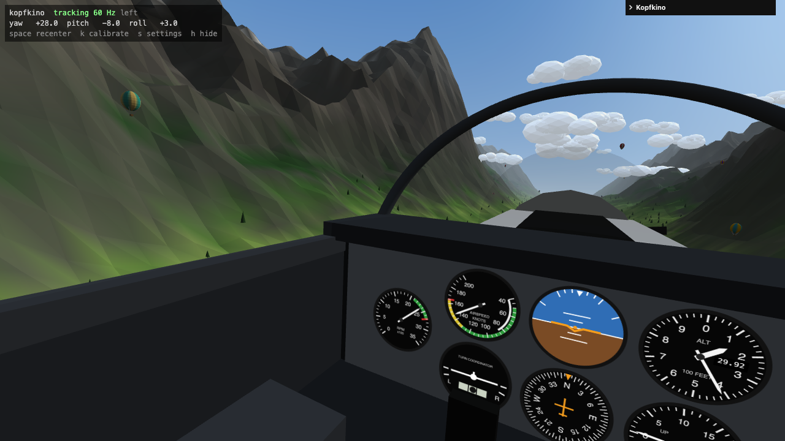

# kopfkino! :3



> Preface: In German, "Kopfkino" (literally "head cinema") is the movie that plays in your head when you daydream! Except this time, the movie actually follows your head!!

## What is kopfkino?!

kopfkino turns your AirPods into a **head tracker** for your Mac! Turn your head left and the cockpit looks left, look up and you see the sky, tilt your head and the whole world tilts with you!!

AirPods Pro (and any AirPods with spatial audio) have a motion sensor inside them that Apple only uses for spatial audio. On Linux, projects like [LibrePods](https://github.com/kavishdevar/librepods) and [MousePods](https://github.com/starman-tech/mousepods) had to reverse-engineer Apple's Bluetooth protocol just to get that data out. Turns out macOS will just *give* it to you, so why not make use of it?

It also sends OpenTrack UDP packets on port `4242`, so eventually you can use it in real flight sims without paying $150 for a TrackIR. It's fully open-source, 100% free, and so simple that even your grandmother could probably figure out how to use it.

## Requirements

- **A Mac on macOS 14 (Sonoma) or newer**
- **AirPods Pro (any model), AirPods Max (any model), or AirPods 3rd gen or newer**

That's it! The installer handles everything else.

## Installation (the easy way!)

Step 1: Open **Terminal**. Press `Command` + `Space`, type `Terminal`, and hit Enter.

Step 2: Copy this whole line, paste it into Terminal, and hit Enter:

```bash
curl -fsSL https://raw.githubusercontent.com/newtontriumphant/kopfkino/main/install.sh | bash
```

Step 3: If a popup asks you to install "command line developer tools", click **Install**, wait for it to finish (5-10 minutes), then paste the line from Step 2 again.

That's it!! The first time, kopfkino opens the flight sim in your browser all by itself and turns on POV mode. If macOS asks if Kopfkino can use motion data or control your computer, click **Allow**. (Yay!)

From now on, you never need Terminal again. Just press `Command` + `Space`, type `kopfkino`, and hit Enter! It pops into your menu bar, and you can open the flight sim from there whenever you want.

## Usage

Put BOTH AirPods in your ears and make sure they're your Mac's sound output (click the Control Center icon in your menu bar → Sound). Then open kopfkino!

kopfkino lives in your **menu bar** (the little spinny gyroscope icon up top). From there you can pick a mode, reopen the flight sim, recenter, or quit.

### Modes!

- **Off**: kopfkino chills and does nothing.
- **POV Mode**: your head is the camera! Works in the flight sim AND in basically any game that uses your mouse to look around (Minecraft, shooters, you name it), because kopfkino just moves the mouse for you. It only kicks in when a game grabs your mouse (like when you're in-game in Minecraft), so the rest of the time your mouse works totally normally! It also sends OpenTrack data for real flight sims.
- **Cursor Mode**: your cursor goes wherever you look on screen, gets a bit bigger so you can actually see it, and gently snaps onto buttons and links. **Nod to click!** You can still use your real mouse whenever, and head tracking takes back over a quarter second after you stop.

The first time you turn on POV or Cursor mode, macOS asks if kopfkino can control your mouse. Click **Open System Settings** and flip the switch next to Kopfkino! (If you missed it, click **Allow Mouse Control…** in the menu bar.)

These shortcuts work everywhere, even mid-game:

- **⌥ Option + ⇧ Shift + K**: turn kopfkino on/off
- **⌥ Option + ⇧ Shift + M**: switch between POV and Cursor mode
- **⌥ Option + ⇧ Shift + R**: recenter (look at the middle of your screen first!)
- **⌥ Option + ⇧ Shift + C**: calibrate

### Calibration

Do this once! Press **⌥ Option + ⇧ Shift + C** (or click **Calibrate…** in the menu bar) and a little voice walks you through it: look at the center of your screen, then the left, right, top, and bottom edges, then tilt your head. Takes about 20 seconds.

kopfkino figures out which way is which AND how far your head moves to reach the edges of your screen (so cursor mode lands exactly where you look). It's saved forever, and you can redo it any time by just running it again!

### The flight sim

If you haven't calibrated yet, press **K** in the sim to do it (same thing as the shortcut).

- **Space**: recenter (look straight at your screen first!)
- **K**: calibrate
- **S**: settings (mode, gain, deadzone, smoothing, FOV, mouse speed, OpenTrack)
- **H**: hide UI, **F**: fullscreen, **P**: pause the plane

Gain is the fun one: at 2x, turning your head 45° looks 90°, so you can check your six without your eyes leaving the screen.

If it says "no airpods data", make sure both AirPods are in and are the active sound output. If that fails, quit kopfkino from the menu bar and open it again. If nothing else works, feel free to contact @zsharpminor on the Hack Club Slack or ask your LLM of choice!

To uninstall, quit kopfkino from the menu bar and paste this into Terminal:

```bash
rm -rf ~/Applications/Kopfkino.app ~/Library/Application\ Support/Kopfkino
```

## For developers

```bash
git clone https://github.com/newtontriumphant/kopfkino
cd kopfkino
./run.sh
```

`run.sh` rebuilds the Swift app when it changes and serves `web/` straight from the repo, so you can edit the sim and just refresh.

## What's next?

Getting this working in X-Plane and other flightsims would probably be the next step, I also want to get Spatial Audio to work in other browsers :)

Made with ♡ by zsharpminor and a decent amount of assistance from claudius
